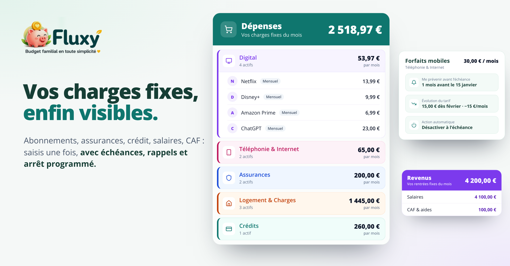

# Fluxy

### Un petit geste. Un mois plus clair.

Le budget du foyer au rythme du quotidien : à chaque dépense saisie, la moyenne par jour est comparée à votre objectif et la fin du mois est estimée. Seul ou à deux.

**[Découvrir Fluxy →](https://fluxy-pied.vercel.app/)** · [Architecture](ARCHITECTURE.md)

## Au quotidien

<table>
<tr>
<td width="50%" valign="top">

<h3>Voir ses charges fixes</h3>

Abonnements, assurances, crédit, salaires et CAF sont saisis une fois, avec échéances, rappels et arrêt programmé.

</td>
<td width="50%" valign="top">

<h3>Avancer à deux</h3>

Chacun a son compte et ajoute ses dépenses. Le foyer partage la même vision du mois.

</td>
</tr>
</table>

**Et aussi :** dépenses et revenus exceptionnels comptés à part, structure financière du mois, et un démarrage possible sans saisir les récurrents.

Visuels réalisés à partir de l’application et de son compte de démonstration. Les montants et les personnes présentés sont fictifs.

---

Conçu et développé par **[Henri Teinturier](https://github.com/HenriTeinturier)** pour rendre le suivi du budget familial plus simple et motivant.

**React · TypeScript · TanStack Start · PostgreSQL · Prisma**

Code source privé

[Visiter Fluxy →](https://fluxy-pied.vercel.app/) · [Les autres projets](https://github.com/HenriTeinturier#des-applications-pour-simplifier-le-quotidien)
